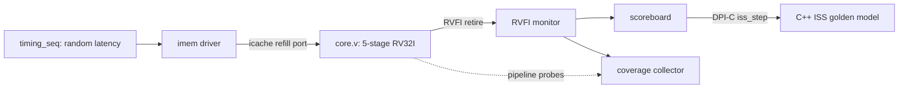

# RV32I 5-stage pipelined CPU with UVM and ISS-lockstep verification

A 5-stage pipelined RISC-V (RV32I) CPU in Verilog, verified by a UVM testbench whose scoreboard checks
every retired instruction against a C++ instruction-set simulator (ISS) through DPI-C. Stimulus comes from
self-checking directed programs and a hazard-targeted constrained-random program generator. Functional
coverage is closed to 100%, and mutation testing shows that the checkers catch injected RTL bugs.

## Results

| Check | Result |
|---|---|
| UVM regression on Vivado xsim, random instruction-memory latency | 13/13 programs pass, every retired instruction compared with the ISS |
| Functional coverage, merged across the regression | 100% of 149 bins in 2 covergroups |
| Mutation testing, 10 injected RTL bugs | 10/10 killed by a 50-test suite ([docs/mutation.md](docs/mutation.md)) |
| Checker sanity test | SUB changed to ADD in the ALU is flagged at the first `sub` that retires |

## Design (`rtl/`)

- **Pipeline:** IF, ID, EX, MEM, WB. Forwarding from EX/MEM and MEM/WB into EX, plus regfile write-through
  from WB into ID. A 1-cycle stall for load-use. Branches and jumps resolve in EX; a misprediction flushes
  IF/ID and ID/EX (2-cycle penalty). Hazard table: [docs/hazards.md](docs/hazards.md).
- **Branch prediction:** 64-entry direct-mapped BTB with 2-bit saturating counters. EX checks every
  prediction, so a predictor bug can only cost cycles, never change results.
- **Instruction cache:** direct-mapped, 64 lines of 16 bytes, refilled one word at a time over a
  request/valid port with variable latency.
- **Retire port:** RVFI-style record per retired instruction (pc, instruction, rd write, memory access),
  which is what all the checkers compare.
- `core_sc.v` is the earlier single-cycle version, kept for reference.

## Verification



- **Golden model (`iss/`):** C++ RV32I ISS that produces the same RVFI record per instruction. Called from
  SystemVerilog with DPI-C (`iss_load`, `iss_step`).
- **UVM environment (`tb/uvm/`):**
  - `imem_agent`: sequence-driven reactive memory; each refill word gets a randomized latency.
  - `rvfi_monitor`: turns each retire into a transaction.
  - `rv_scoreboard`: steps the ISS once per retire and compares all 11 RVFI fields; the first mismatch is
    printed field by field and fails the test.
  - `rv_coverage`: functional coverage (below).
- **Stimulus:**
  - 9 self-checking directed programs in `sw/tests/` (ALU, control flow, hazards, branch predictor,
    icache conflicts, loops, and `t_cov` for coverage holes).
  - `gen/gen.py`: constrained-random programs that are legal by construction and biased toward hazards
    (RAW at distance 1 to 3, load-use, store-then-load, wrong-path stores, icache conflict misses).
- **Functional coverage:**
  - `cg_retire`, sampled on every retired instruction: all 39 RV32I instructions, RAW distance for rs1
    and rs2 (including load-use), branch type x taken x direction, load/store byte lanes, sign extension,
    store-then-load distance, reads and writes of x0, jump kinds.
  - `cg_pipe`, sampled every cycle from pipeline probes: which forwarding path fed each operand
    (including both matching, where the youngest must win), regfile write-through, load-use stalls,
    branch-prediction outcomes (correct, missed, false taken, wrong jalr target), and stalls or flushes
    during an icache refill.
  - Closure: the first merged run left 12 bins uncovered (backward `beq`/`blt`/`bge`/`bltu`/`bgeu`, a
    wrong jalr target, a load-use stall during a refill). They came from limits of the random generator,
    so `sw/tests/t_cov.S` targets them directly.
- **Mutation testing (`scripts/mutate.py`):** injects one bug at a time (forwarding, load-use stall,
  flush, x0, sign extension, branch immediate, icache fill, BTB) and runs the suite in lockstep.
  Functional bugs are caught by the ISS comparison; BTB bugs only change timing, so they are caught by
  comparing cycle counts with the unmodified design.

## Running

### UVM on Vivado xsim (Windows)

```bat
call C:\AMDDesignTools\2026.1\Vivado\settings64.bat
tb\uvm\build.bat
tb\uvm\sim.bat t_basic rand
tb\uvm\regress.bat
```

`sim.bat <program> [fast|rand|slow]` runs one program. `regress.bat` runs every program in `programs\`,
prints PASS/FAIL, and writes a merged coverage report to `covreport\dashboard.html`.
`set NODPI=1` before `build.bat` builds without the ISS (environment bring-up only).

### Verilator flow (Linux)

Needs Verilator 5 and a `riscv64-elf-` GCC toolchain.

```sh
make -C iss                 # ISS -> build/iss_rv32
make -C sw                  # directed programs -> build/sw/*.bin
make -C tb/directed         # lockstep simulators, with and without the predictor
scripts/lockstep.sh         # directed programs, ISS vs RTL
scripts/randtest.sh 100     # 100 random seeds
python3 scripts/mutate.py   # mutation testing
scripts/cpi.sh              # cycles and CPI with and without the predictor
```

## Repository layout

| Path | Contents |
|---|---|
| `rtl/` | core, decode, ALU, regfile, branch predictor, icache |
| `iss/` | C++ ISS and its DPI-C wrapper |
| `tb/uvm/` | UVM environment, coverage, and the xsim scripts |
| `tb/directed/` | Verilator testbench with the lockstep checker |
| `sw/tests/` | directed assembly tests |
| `programs/` | prebuilt `.bin`/`.hex` programs used by the UVM regression |
| `gen/` | constrained-random program generator |
| `mutants/`, `scripts/` | mutation definitions, lockstep, random, mutation and CPI scripts |
| `docs/` | devlog, hazard table, mutation results |

## Limitations and next steps

- RV32I only. The ISS already takes XLEN as a compile flag; the RV64 extension is planned.
- No CSRs or interrupts: `ecall` or an illegal instruction ends the program.
- The icache has no `fence.i`, and a refill in progress is not cancelled on a redirect.
- Data memory is a fixed-latency model.
- Next: SVA assertions and formal checks, then CI.
